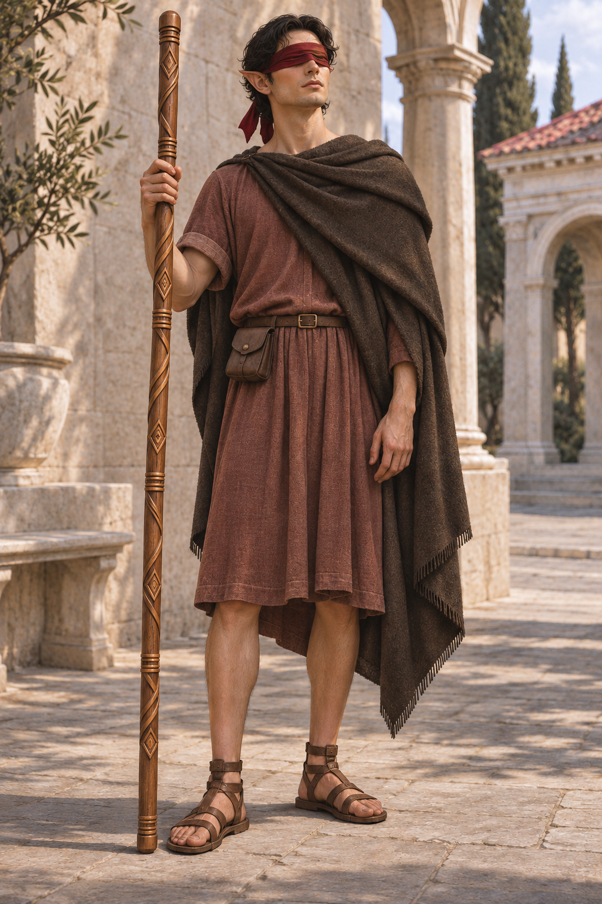

# Haju the Blind Wizard

## Info box

| Fact | Description |
| --- | --- |
| People | Elf |
| Story role | Protagonist of the first story |
| Sight | Formerly sighted; now blind |
| Magical innovation | First wizard to develop sensory magic |
| Way of life | Solitary and homeless; clean and well-kempt |

Haju is an elven wizard and the protagonist of the first story. Formerly sighted, he develops sensory magic after becoming blind, driven particularly by his reluctance to depend on other people. A loner without a permanent home, he nevertheless keeps himself clean and well-kempt.

His central story concerns his reluctant emergence as a surrogate father to an orphaned human girl.

## Independence and Magical Perception

Haju values his independence and dislikes having to rely on others. His loss of sight gives him a powerful personal reason to pursue magical perception: he wants to navigate his life without depending on other people.

Through great effort, he learns to use a point in space as the source of his perception, moving that point at will. He is the first wizard to develop sensory magic. The precise nature and limitations of this perception, including how closely it resembles ordinary eyesight, remain to be established.

The cause and timing of his blindness, and whether he studied magic before losing his sight, are not yet established.

## Way of Life and Character

Haju is a loner and lives without a permanent home. Despite his homelessness, he maintains a clean, well-kempt appearance. His solitude and attachment to independence form an important contrast with the responsibility he unexpectedly takes on for the girl.

## The Orphaned Girl

Haju inadvertently becomes a surrogate father to an orphaned human girl. He decides to care for her, though he is not pleased about taking on that responsibility. His initial reason for doing so remains undecided.

In Haju's culture, humans occupy one of the lowest positions within slavery. The girl's circumstances and the exact legal or social nature of her relationship with Haju remain to be developed; his role as her caregiver does not yet establish whether he owns her, frees her, or encounters her under some other arrangement.

Their relationship is the central arc of the first story, bringing his desire for a solitary, independent life into tension with his growing responsibility for another person.

## Development Notes

The following are creative directions rather than settled details of the setting:

- **Classical inspiration:** Haju's locale and the story's visual styling draw heavily on Greco-Roman traditions, giving the setting an older-than-medieval feel. Specific institutions, politics, and historical parallels remain undecided.
- **Philosophical inspiration:** Haju's way of life draws on the image of Diogenes of Sinope, the Cynic philosopher associated with radical simplicity and the anecdote of discarding his drinking bowl after seeing a child drink with his hands. Haju is not a direct counterpart: his cleanliness and careful grooming are deliberate features of his characterization. No in-world philosophical affiliation has yet been established.
- **Magical plot connection:** The girl may possess, embody, or otherwise be connected to a magical object or phenomenon that drives the external plot. The nature of that connection and its role in bringing her and Haju together remain undecided.
